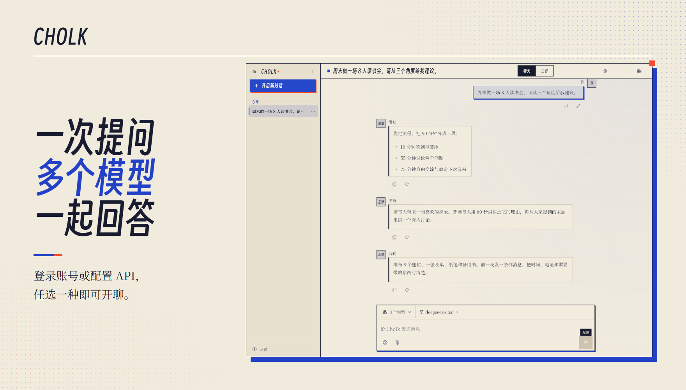
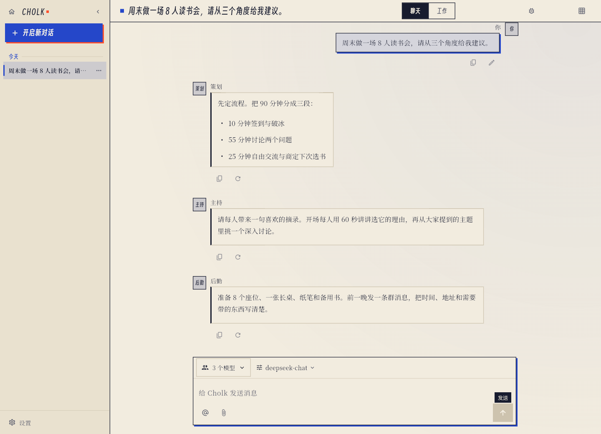
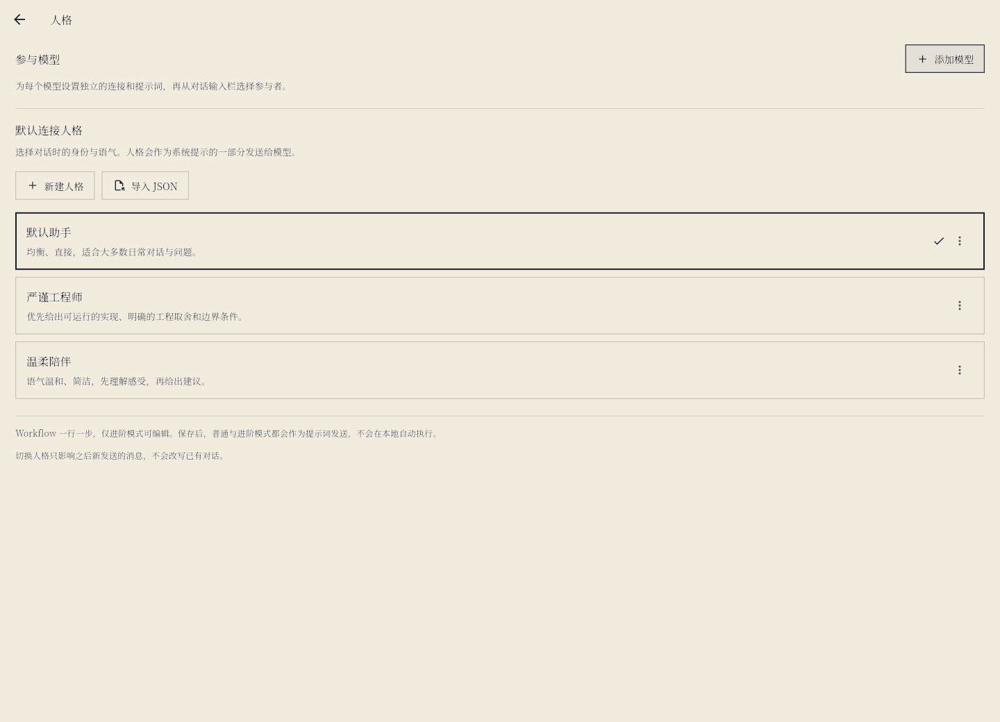
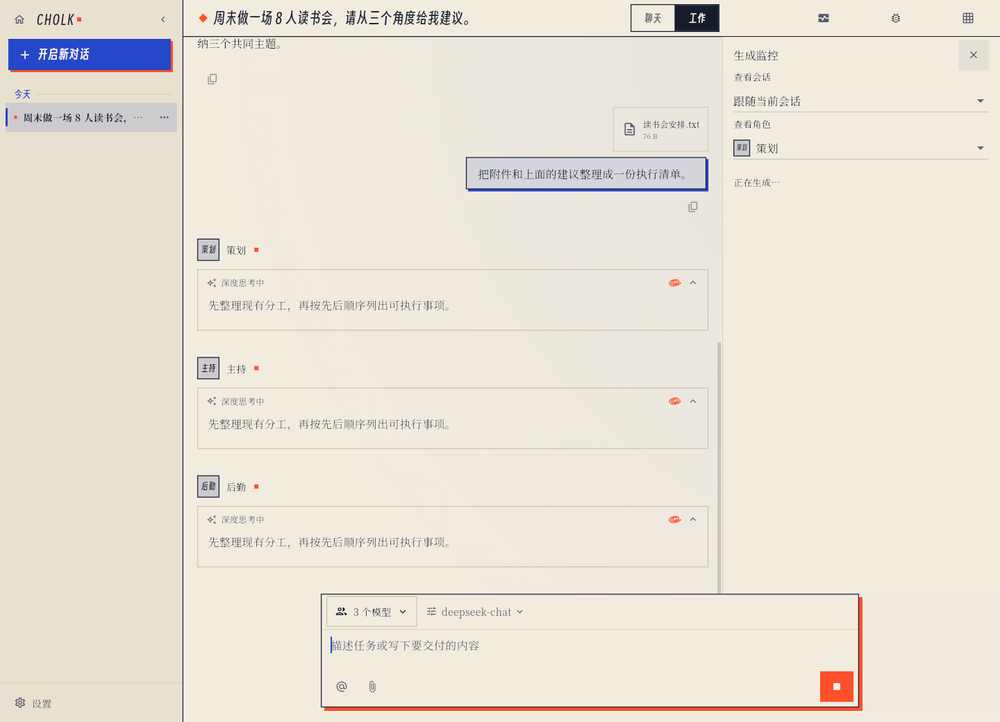
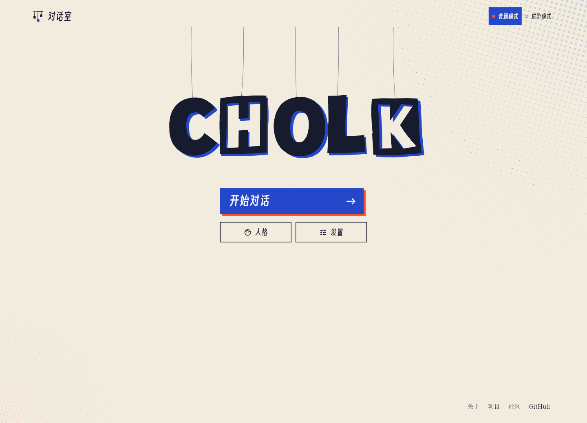

# Cholk

Cholk 是一个和 AI 角色聊天的应用，支持 Android 和 Windows。你可以给每个角色设定名字、头像和性格，然后像在聊天软件里一样和它们对话。一个对话里可以有多个角色，它们会分别回复你。

Cholk 本身不提供 AI 模型。你需要用以下两种方式之一连接模型：

- 登录一个账号服务。账号服务由别人部署好，你只需要输入它的地址、账号和密码。
- 填写你自己的 API Key。Cholk 支持 DeepSeek API 和与 OpenAI 格式兼容的 API。



## 下载

Android 安装包（APK）在本仓库的 [Releases](https://github.com/iv3rins/cholk/releases) 页面。下载最新版本的 `.apk` 文件，在手机上打开它即可安装。手机可能会提示「允许安装未知来源的应用」，需要你手动允许。

Windows 版目前没有安装包。你需要按下文「从源代码构建」的步骤自己构建。

## 主要功能

**和多个角色聊天。** 一个对话里可以加入多个角色。每个角色有自己的名字、头像、性格提示词和模型。你可以让所有角色一起回复，也可以用 `@角色名` 只让一个角色回复。回复按聊天软件的样式显示：你的消息在右边，角色的消息在左边。



**自定义人格。** 人格是一段描述角色性格和说话方式的文字，Cholk 会把它发给模型。你可以新建人格，也可以修改内置人格。修改内置人格时，Cholk 会保存一份副本，原来的人格不变。人格可以导出为 JSON 文件，发给别人导入。



**聊天模式和工作模式。** 每个对话可以选择聊天模式或工作模式。聊天模式适合日常陪伴。工作模式会让回复先给结论，并显示每个角色的生成进度。



**普通模式和进阶模式。** 首页可以选择普通模式或进阶模式。普通模式只显示必要的设置，适合第一次使用 AI 的人。进阶模式可以设置 API 协议、地址和模型，还可以为人格编写分步骤的工作流程。



## 开始使用

安装后打开 Cholk，先连接模型。

1. 如果你有账号服务的地址，打开「设置 → 服务器与账号」，输入地址，然后注册或登录。登录后，Cholk 会自动读取可用的模型。
2. 如果你有自己的 API Key，在首页选择「进阶模式」，再打开「设置 → 高级 API 设置」。填写协议、API 地址、Key 和模型名称。OpenAI 兼容的地址要包含服务商要求的路径，例如 `https://api.openai.com/v1`。
3. 回到聊天页面，在输入框旁边选择人格或角色，然后发送消息。

## 你的数据存在哪里

聊天记录、人格和设置都保存在你自己的设备上。你填写的 API Key 也只保存在本机。Cholk 只把消息发送到你配置的账号服务或 API 地址，不发送到其他地方。

## 从源代码构建

构建前请安装以下工具：

- Flutter 3.50.0（包含 Dart 3.14.0）
- 构建 Android 版需要 Android SDK 和 JDK 17
- 构建 Windows 版需要 Visual Studio 的「使用 C++ 的桌面开发」组件

在仓库根目录运行：

```shell
flutter pub get
flutter test
flutter build apk --release      # Android，输出在 build/app/outputs/flutter-apk/
flutter build windows --release  # Windows，输出在 build/windows/x64/runner/Release/
```

开发时可以用 `flutter run -d windows` 或 `flutter run -d <设备 ID>` 直接运行。`flutter devices` 会列出可用的设备。更多构建和排错说明见[开发与验证手册](docs/DEVELOPMENT.md)。

## 可选的服务端

仓库里还有两个独立的 Node.js 服务。只用自己的 API Key 时，你不需要它们。

- [账号服务](server/README.md)（`server/`）：让多个用户用账号登录 Cholk。模型的 API Key 只保存在服务端，用户看不到它。
- [DeepSeek 代理](proxy/README.md)（`proxy/`）：把请求转发到 DeepSeek API。客户端使用代理令牌，不直接持有 DeepSeek 的 Key。

两个服务都需要 Node.js 22.13 或更高版本。部署前请复制各自目录下的 `.env.example` 为 `.env`，再填写你自己的值。不要把 `.env` 文件提交到仓库。

## 目录结构

```text
lib/       应用代码：界面、对话逻辑、API 连接和本地存储
test/      自动化测试
assets/    字体和提示音
android/   Android 工程
windows/   Windows 工程
web/       浏览器预览入口（只用于开发）
server/    可选的账号服务
proxy/     可选的 DeepSeek 代理
tool/      开发用的浏览器预览工具
docs/      开发文档和截图
```

## 许可证

本项目使用 [MIT 许可证](LICENSE)。

内置字体使用 SIL Open Font License，许可证文件在 `assets/fonts/` 目录中。DeepSeek 协议和早期界面参考了 [deepseek-ai/chat-demo](https://github.com/deepseek-ai/chat-demo)，该项目同样使用 MIT 许可证。
