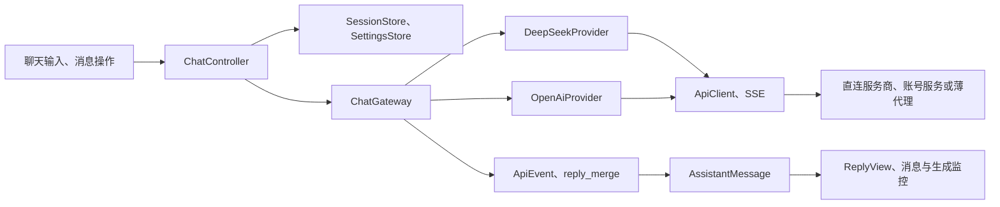

# Cholk 工程交接报告

Cholk 是一个以陪伴聊天和远程办公为产品方向的 Flutter 应用，Dart 包名为 `deepseek_chat`。Windows、Android 是原生运行目标，Flutter Web 用于界面预览和本地集成验证。完整检出包含客户端、账号服务和可选 DeepSeek 代理。环境准备、启动和验证命令见 [开发与验证手册](DEVELOPMENT.md)。

## 产品定义与交付边界

首页的「普通 / 进阶」决定连接与设置的复杂程度。会话里的「聊天 / 工作」决定会话交互和提示词。两个选择维度分别保存在应用设置和会话模型中，组合使用。

| 场景 | 产品目标 | 当前交付 |
| --- | --- | --- |
| 陪伴聊天 | AI 新手可以用账号或 API 开始聊天，自定义人格、分享人格卡并导出记忆 | 服务器登录、手动连接、按会话选人格、多人回复、会话分支与本地历史已实现。可导入和导出 v1 人格 JSON，文件可直接分享。|
| 记忆 | 用户可以查看、导出并迁移陪伴形成的记忆 | 当前请求会使用当前会话的可用历史。设置层保留了 `memorySync` 字段及其保存方法。跨会话记忆模型、检索或同步、记忆导出和历史归档属于待定义、待实现的能力。|
| 远程办公 | 工作模式可经 MCP 或 Hooks 连接 DeepSeek Harness、Pi、ChatGPT 等 Agent | 当前工作模式复用模型对话链路，按模式选择人格，在提示词中传递 Workflow，并显示生成监控。MCP/Hooks 适配、外部 Agent 的任务会话、远程执行和工具授权属于后续集成。|
| 新手连接 | 以尽可能少的步骤完成登录或 API 连接 | 默认普通模式。用户填写服务地址、账号与密码，注册或登录后读取模型列表。首次默认模型取有效偏好或列表首项。手动 API 参数集中在进阶模式，支持验证当前表单。首装免输地址和托管服务默认预配置属于可评估的体验改进。|
| 界面设置 | 提供可读的纸面背景和个性化选项 | 素纸、横线、方格、点阵可选。自定义图片目前有 `chatBackgroundImageBase64` 存储字段和控制器方法，界面选图与聊天背景渲染待接入。|

进阶模式支持编辑 Workflow，每行一步。运行时 `ChatController._systemFor()` 把步骤编入发送给模型的提示词。将来接入远程 Agent 时，需要先定义运行会话、事件、取消和授权的边界，再决定 MCP 或 Hooks 适配方式。命令、工具调用和任务产物适合由运行时单独表示；现有 `Persona.workflow` 是可分享的提示词数据。

## 工程结构与入口

```text
deepseek_chat/
  lib/
    main.dart、app.dart  应用启动、主题与界面装配
    models/             会话、消息、成员、连接配置、人格和偏好
    state/              ChatController，管理会话和请求生命周期
    chat/               上下文筛选、附件策略、事件合并、回复视图
    api/                HTTP/SSE、账号客户端、协议路由与 provider
    storage/            应用设置与原生/Web 会话存储
    ui/                 首页、聊天、人格、角色档案、设置和共享控件
    theme/、i18n/       线条主义主题、中英文文案
    demo/               Web 演示数据
  android/、windows/     原生平台入口和插件工程
  web/                   Web 预览入口
  assets/                本地字体和声音
  test/                  Dart 单元测试、Widget 测试和本地传输测试
  server/                独立账号服务，附 SQLite 存储与 OpenAI 流式代理
  proxy/                 独立可选代理，转发 DeepSeek 协议并附本地模拟上游
  tool/                  Web 开发预览服务器与移动预览页
  docs/                  交接、开发和 AI 协作资料
```

- `main()` 初始化 Flutter 和 `ChatController.init()`，加载设置、人格、档案、会话索引和草稿，再启动 `DeepSeekChatApp`。Web 可通过 Dart define 注入演示会话或测试连接。 [应用入口](../lib/main.dart)
- `DeepSeekChatApp` 装配 MaterialApp、主题、语言与首页。`AppScope` 为 UI 提供控制器、调色板和本地化文案。首页 `MainScreen` 打开 `ChatPage`，后者组合会话侧栏和 `ChatView`。人格与设置各自持有界面流程，背景选项和聊天背景绘制分属设置、聊天目录。存储层拥有文件和偏好读写，provider 拥有服务商的字段和事件转换。 [应用装配](../lib/app.dart) [界面作用域](../lib/ui/app_scope.dart) [首页](../lib/ui/home/main_screen.dart) [聊天工作区](../lib/ui/chat/chat_page.dart)
- `server/src/index.js` 启动账号服务。`createApp()` 负责 HTTP 路由、请求限额、CORS、登录限流、上游转发和关闭流程。`Accounts` 拥有用户与认证会话的 SQLite 表、密码派生和令牌处理。 [账号服务入口](../server/src/index.js) [HTTP 路由](../server/src/app.js) [账号存储](../server/src/accounts.js)
- `proxy/src/index.mjs` 单独启动薄代理。`createProxyServer()` 接收客户端代理令牌，换成服务端 DeepSeek Key，并在限定的路由上转发请求。该服务独立配置和测试。 [薄代理](../proxy/src/proxy.mjs)

## 请求生命周期



| 入口或方法 | 调用契约 |
| --- | --- |
| `ChatController.sendMessage(text, files)` | 返回是否接受发送。必要时先加载选中会话，再解析回复目标。写入用户消息和各目标的 pending 回复，锁住当前会话的请求批次，异步发起流式请求。|
| `setRoomMembers()`、`setChatModel()`、`AgentMentions.resolve()` | 管理房间成员、默认回复模型和 `@` 路由。可解析的提及优先；否则使用已选成员，最后回退到默认助手。同一个模型可在同一房间由多个成员使用。|
| `_runBatch()`、`stopReply()` | 同轮各回复并行执行，稳定保留创建顺序；各目标持有取消令牌。批次收尾更新摘要并保存。停止使用当前会话的批次令牌。历史投影将同轮可用公开回复按发言人署名后发给后续请求。|
| `regenerate()`、`editPrompt()`、`switchVersion()`、`continueReply()` | 编辑和重新生成写入新分支，可切回旧版本。续写沿用已有回复及其连接引用，允许手动停止和达到输出上限等符合资格的状态。|
| `ChatGateway.verify()`、`stream()` | 验证连接快照并请求模型列表，或按协议返回 `Stream<ApiEvent>`。配置变化对后续请求生效。|
| `applyApiEvent()`、`settleReply()`、`buildReplyView()` | 先把流事件合并为消息块，再结算状态、停止原因和错误，最后从块推导思考、正文、搜索步骤与引用。续写收到拒绝时保留先前回答。|

单个模型先经历 pending/streaming，再收敛为 done、stopped 或 error。内容分片按约 60 ms 节流，工作区导航与设置有独立通知。生成监控可查看后台会话和指定角色；调试面板最多保留 40 条内存记录，可见模型、状态、人格与有效 System Prompt，关闭面板会清空记录。 [控制器](../lib/state/chat_controller.dart) [网关](../lib/api/chat_gateway.dart) [请求载体](../lib/chat/chat_request.dart) [事件合并](../lib/chat/reply_merge.dart) [生成监控](../lib/ui/chat/generation_monitor.dart)

## 连接、协议和凭据

| 连接路径 | 运行契约 |
| --- | --- |
| 账号登录 | `AccountClient.authenticate()` 调用 `POST /auth/register` 或 `POST /auth/login`，提交 `{username,password}` 并接收 `{username,token}`，再以 Bearer 访问 `GET /v1/models`。完成模型列表校验后发布登录状态。`logout()` 先清除本地状态，再调用 `POST /auth/logout` 吊销对应令牌，预期 204。|
| 账号对话 | 客户端用账号令牌请求配置地址的 `POST /v1/chat/completions`。模型引用绑定账号服务地址与模型名。账号服务校验令牌、流式请求与字段白名单，用服务端固定 Key 请求上游。使用普通模式并已配置服务地址时，应用等待该服务的有效登录。|
| DeepSeek | `DeepSeekProvider` 使用 `GET /models` 验证、`POST /anthropic/v1/messages` 发送，带文件时先调用 `POST /anthropic/v1/files`。该路径支持专用工具、thinking、reminder、标题和引用，SSE 以 `message_stop` 收尾。可经过 `proxy/` 将真实 Key 保留在服务端。|
| OpenAI-compatible | API 根地址保留服务商要求的路径，常见配置包含 `/v1`。适配器追加 `/models` 或 `/chat/completions`，发送 Bearer 与 `stream: true`。解析索引为 0 的 choice、`finish_reason`、usage 和 `[DONE]`，再归一化为同一套内部事件。|

`normalizeServerAddress()` 接受 HTTPS，以及回环地址上的 HTTP。账号请求禁用重定向，登录、查询模型和登出各有 40 秒请求期限。令牌、用户名和模型列表保存在 `AccountClient` 内存，重新启动或刷新后需登录。服务器地址与无凭据的模型偏好会持久化。手动 API 的 Key 随连接配置保存在 SharedPreferences，连接资料的生产级凭据存储属于后续改进。服务端 SQLite 中 `users` 存加盐 scrypt 密码派生值，`sessions` 存令牌 SHA-256 摘要、用户外键、创建时间和到期时间。账号及首个认证会话由同一 SQLite 事务写入。 [客户端鉴权](../lib/api/account_client.dart) [服务端 API 契约](../server/README.md)

账号服务对无效认证返回 401，默认关闭注册，重复用户名返回 409，注册和登录分别按来源地址限流。默认上限是完整 JSON 请求 1 MiB，包含历史、内联文件和序列化开销。通过 `MAX_BODY_BYTES` 可调整。按模型校验的客户端附件限制与此网关限制分别生效，超限会在发送后得到 413 提示。等待上游响应头超时会返回 502。DeepSeek 代理默认有 80 MiB 请求体预校验上限，转发回包按流处理，客户端断开会中止上游。 [账号配置](../server/README.md#环境变量) [薄代理配置](../proxy/README.md)

## 领域对象与持久化

| 类型或表示 | 拥有的数据与行为 |
| --- | --- |
| `AppSettings` / `ModelConfiguration` | 前者是可变用户偏好，后者是请求所用的不可变连接值，含协议、API 根地址、Key、模型和媒体能力。通过 `validated()` 规范化并校验，`copyWith()` 产生新值。|
| `ChatModelRef` / `ChatMember` / `ChatParticipant` | `ChatModelRef` 存模型和连接来源，服务端模型带 `server_address`，手动连接带 `manual_source` 和可选 `profile_id`。`ChatMember` 是房间成员，表单可编辑昵称、模型、头像和提示词。模型可序列化 `persona_id`，房间成员表单尚无已存人格选择器。`ChatParticipant` 是全局档案，持有独立配置与展示身份。回复保留发言时的身份和模型来源。|
| `ChatSession` / `SessionSummary` | 原生正文包含 `id`、`title`、毫秒时间戳、`messages` 与可选 `root_message_id`。会话可另含 `mode`、`model_ref`、`members`、选择 ID，以及 `chat_persona_id` 和 `work_persona_id`。摘要只有 ID、标题和时间，用作侧栏索引。|
| `ChatMessage` / `ReplyBlock` | 共有字段 `id`、`created_at`、`parent_id`、`selected_child_id`。`UserMessage` 存 `content` 和 `files`；`AssistantMessage` 存段落块、请求状态、停止原因、模型引用、用量与错误。块包括正文、思考、服务端工具、搜索和链接结果。|
| `FileAttachment` | 保存 ID、名称、大小、MIME、本地路径，可记录远端 ID 和来源。字节、上传状态和错误是运行态。DeepSeek 文件 ID 按地址、Key 和附件 ID 在当前进程隔离缓存。兼容接口按能力将 UTF-8 文本、图片 `image_url`、PDF `file` 和 WAV/MP3 `input_audio` 编入内容。|
| `Persona` | 内置人格有双语定义，自定义人格保存一个名称、提示词和可选流程。`exportJson()` / `importJson()` 使用 v1 JSON；`toStorageJson()` 额外保存本地 ID，导入生成新 ID。编辑内置人格会保存自定义副本。|

`ChatSession.visibleMessages` 从根沿选中子节点生成可见路径。`appendBranch()` 建立链接并选中新分支，`selectVersion()` 切换可见层的兄弟节点。`normalized()` 为旧线性记录补父子链，旧 `persona_id` 按会话模式迁移到对应的人格字段。`contextRounds()` 取可用的相邻用户和助手轮次，`sharedGroupHistory()` 把同一轮的可见回答合并为一条带署名的助手消息。 [会话与消息模型](../lib/models/chat_models.dart) [连接引用](../lib/models/chat_member.dart) [上下文构造](../lib/chat/context_builder.dart) [群聊历史](../lib/chat/group_history.dart)

以下 v1 文件可在设备间交换人格配置。

```json
{
  "version": 1,
  "name": "耐心伙伴",
  "system_prompt": "先理解对方的感受，再给出简短回应。",
  "workflow": ["理解语境", "自然接话"]
}
```

文件交换范围是人格配置。会话历史、长期记忆、账号凭据、模型绑定和图片资产有各自的数据边界。 [人格数据契约](../lib/models/persona.dart)

| 持久化位置 | 数据与边界 |
| --- | --- |
| SharedPreferences `deepseek_chat:*` | 应用偏好、服务器地址、手动连接、模型引用、全局档案、自定义人格。先解析兼容旧键，再应用可读的新版连接记录。|
| `<ApplicationSupportDirectory>/deepseek_chat/` | `sessions/<id>.json` 存完整消息树，`sessions_index.json` 存摘要，`drafts.json` 按会话或 `__new__` 存输入，`files/` 保存附件原件。原生文件变更排队，单个 JSON 经临时文件替换。索引和正文的替换各自完成，进程中断后可能需要重建索引。|
| Web `SessionStore` | 内存在当前页面保留会话、草稿与附件，刷新重置。设置仍由平台 SharedPreferences 实现保存。|
| 账号服务 `DATABASE_PATH` | 默认 `server/data/accounts.db`，包含用户账户和认证会话。聊天记录由客户端存储。|

单会话删除清理会话正文和索引；「删除所有对话」清理原生会话目录、附件、索引和草稿。原生 `SessionStore` 的存储格式是内部数据契约。后续若实现记忆导出，应先定义跨版本格式、导出范围和附件规则。 [原生存储](../lib/storage/session_store_io.dart) [Web 存储](../lib/storage/session_store_web.dart) [设置存储](../lib/storage/settings_store.dart)

## 设计风格与维护原则

- **线条主义。** 以纸色、墨线、信号橙和四级线宽建立层级，配 Cholk Serif 中文衬线字体。背景纸纹、悬挂字标和线条交互有各自的绘制实现，与消息和网络生命周期独立。字标及线条实验响应减少动效偏好。桌面使用侧栏，窄屏使用抽屉。 [设计令牌](../lib/theme/lineism.dart) [应用主题](../lib/theme/app_theme.dart) [首页字标](../lib/ui/home/hanging_wordmark.dart)
- **文案服务于状态与操作。** 普通用户优先看到登录、模型选择、人格和发送入口；进阶用户按需打开连接字段、Workflow 和诊断。双语文案由 `S` 和页面组件提供，日期、文本输入等平台行为使用 Material 本地化。 [双语文案](../lib/i18n/strings.dart)
- **独立变化放在所有者处。** 新增协议时优先扩 adapter 并继续输出 `ApiEvent`。修改聊天规则时沿请求意图、上下文、回复合并和 UI 的既有接口验证。修改落盘数据时保留旧数据加载，并明确 native/Web 差异。把重试、取消和路由状态放在其生命周期的所有者处。 [内部事件类型](../lib/api/api_types.dart)
- **按现实约束拆分。** `ChatController` 当前协调会话、批次、草稿和设置，保留现有可测入口。后续提取以独立状态所有权和具体回归为依据。账号服务和薄代理有不同的认证与上游职责，可独立部署和升级。 [会话控制器](../lib/state/chat_controller.dart) [账号服务](../server/README.md) [薄代理](../proxy/README.md)

## 测试矩阵与证据边界

| 层级 | 主入口与覆盖 | 发布前仍需确认 |
| --- | --- | --- |
| Flutter 单元与本地传输 | `flutter test`。覆盖 SSE 拆帧、两种 provider 的请求和响应转换、附件规则、配置快照、拒绝与续写、账号超时和旧数据迁移。| 用已配置的真实模型复核协议扩展、媒体支持、默认模型名和服务端限额。 |
| Flutter 状态与 Widget | `flutter test`。覆盖会话加载和删除竞态、并行回复、原连接引用隔离、人格 JSON 交换、两种会话模式、桌面/紧凑布局、减少动效、流式刷新范围。| 真机确认触摸、软键盘、文件选择、设备姿态、音效和发布包行为。 |
| 账号服务 | 在 `server/` 执行 `npm run check` 和 `npm test`。本地模拟上游与临时 SQLite 覆盖注册、哈希、事务、令牌吊销、CORS、请求大小、流断开与服务关闭。 | 部署环境确认代理转发、HTTPS、数据库备份和并发。 |
| DeepSeek 薄代理 | 在 `proxy/` 执行 `npm test`。本地上游覆盖 Key 替换、许可路由、SSE、下游断开后取消上游、压缩字节一致性和 multipart。 | 用部署环境确认 SSE 代理缓冲、网络和上传资源预算。 |
| 浏览器与平台 | `flutter analyze`、Web 构建、本地浏览器预览和账号/代理 smoke。见 [开发与验证手册](DEVELOPMENT.md)。 | Android、Windows 的签名与分发、真实上游端到端和高并发压测需要目标环境。 |

测试定位从 [Flutter 协议测试](../test/provider_test.dart)、[会话生命周期](../test/session_lifecycle_test.dart)、[账号控制器](../test/chat_account_controller_test.dart)、[人格交换](../test/persona_transfer_test.dart)、[流式刷新](../test/reply_delivery_test.dart)、[账号服务测试](../server/test/app.test.js) 和 [薄代理测试](../proxy/test/proxy.test.mjs) 开始。目标边界中，记忆和 Agent 集成在行为定义后再建立对应的端到端验收。Android 当前 release 构建配置使用 debug 签名，正式分发需要独立签名配置。 [Android 构建配置](../android/app/build.gradle.kts)

2026-11-19 结构整理验收中，Flutter 静态分析无问题，Flutter 120 项、账号服务 14 项和薄代理 12 项测试通过，账号服务语法检查通过。Web 演示构建成功，本地 HTTP 检查确认首页与手机预览页可访问，迁移后的薄代理可从模拟上游转发至 `message_stop`。

Android `assembleDebug` 使用本机网络代理获取依赖后构建成功，`apksigner verify` 通过，包名为 `com.lovemachine.deepseek_chat`。Android 真机运行、Windows 原生构建和真实服务商联调待验证。

## AI 辅助开发

跨模块改动可由其他模型负责独立审查和规划，GPT 负责实现、集成和最终验收；局部改动直接沿现有入口验证即可。 [Agent Team 协作指南](ai/AGENT_TEAM.md) [使用 GPT-6.2 中文译文](ai/译文-Using-GPT-6.2.md)

